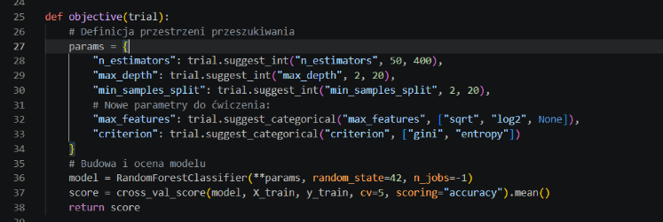
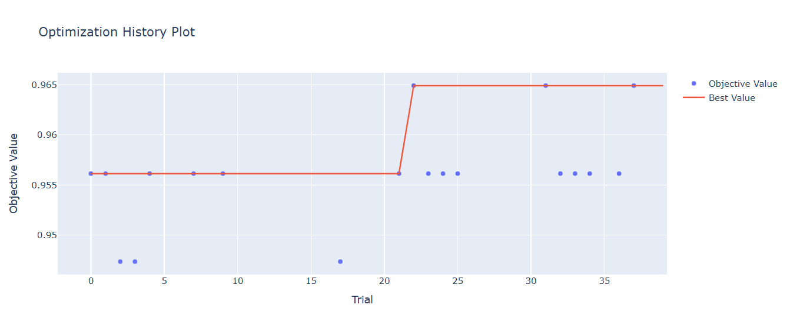
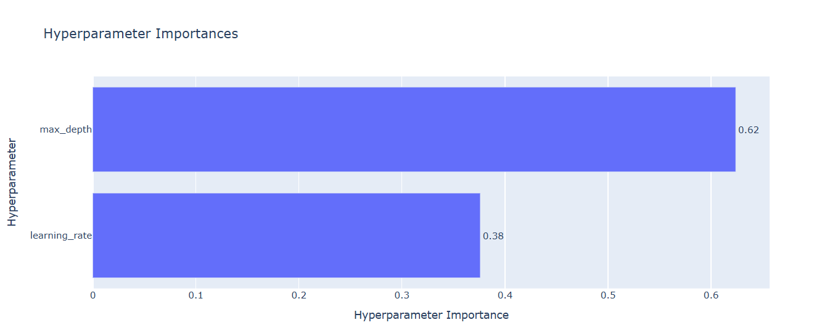

### Ćwiczenie nr 1: Rozszerzenie przestrzeni przeszukiwania

### Ćwiczenie nr 2: Porównanie z modelem bazowym

| Model | Dokładność CV (Walidacja Krzyżowa) | Dokładność Testowa |
| :--- | :--- | :--- |
| Bazowy | 0.9538 | 0.9561 |
| Strojony | 0.9604 | 0.9561 |

**Czy strojenie przyniosło poprawę?**
Strojenie poprawiło wynik walidacji krzyżowej (wzrost z ok. 95,38% do 96,04%), jednak dokładność na zbiorze testowym pozostała na identycznym poziomie (95,61%). Oznacza to, że w kontekście ostatecznej zdolności modelu do generalizacji na zupełnie nowych danych, optymalizacja w tym konkretnym przypadku nie przyniosła wymiernej poprawy względem domyślnych ustawień biblioteki `scikit-learn`.

**Czy relacja między wynikiem walidacyjnym a testowym wskazuje na nadmierne dopasowanie?**
Nie ma tutaj mowy o nadmiernym dopasowaniu (overfittingu). Różnica między dokładnością walidacji krzyżowej (96,04%) a dokładnością testową (95,61%) jest minimalna i wynosi ułamek punktu procentowego. Wyniki są bardzo stabilne, co świadczy o tym, że wybrane przez Optunę hiperparametry dobrze uogólniają się na nowe dane, a sam algorytm dla tego podziału osiągnął prawdopodobnie pułap swoich możliwości.

### Ćwiczenie nr 3: Interpretacja wizualizacji

#### 1. Historia optymalizacji (`plot_optimization_history`)
* **Co przedstawia wykres:** Wykres przedstawia wartości funkcji celu (dokładność walidacji krzyżowej) uzyskiwane w kolejnych próbach optymalizacji oraz linię wyznaczającą najlepszy dotychczasowy wynik. 
* **Wnioski praktyczne:** Pozwala on ocenić dobór budżetu obliczeniowego – jeśli linia najlepszego wyniku ulega wyraźnemu wypłaszczeniu, dalsze próby nie przynoszą już poprawy, co sygnalizuje zakończenie procesu poszukiwania.

#### 2. Ważność hiperparametrów (`plot_param_importances`)
* **Co przedstawia wykres:** Wykres szacuje względny (procentowy) wpływ poszczególnych hiperparametrów na wartość optymalizowanej funkcji celu.
* **Wnioski praktyczne:** Dzięki niemu można zidentyfikować parametry kluczowe dla modelu i pominąć te o znikomej ważności, koncentrując przyszły budżet obliczeniowy wyłącznie na przeszukiwaniu najbardziej istotnych zmiennych.

